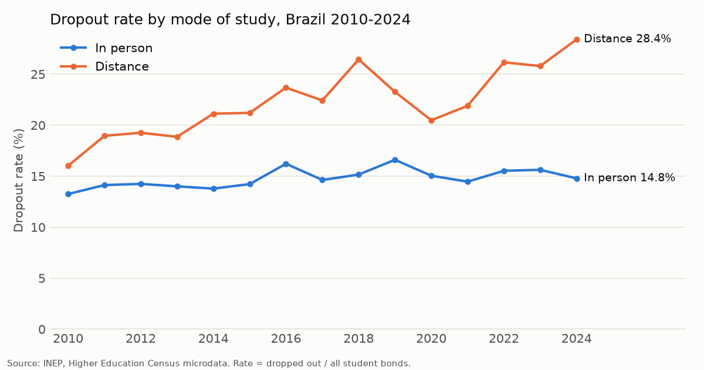

# brazil-higher-ed-dropout

**English** · [Português](README.pt-BR.md)

A reproducible pipeline for the Brazilian Higher Education Census microdata (INEP, 2010 to 2024). It
downloads the files, validates them, converts them to Parquet and calculates dropout rates with DuckDB.
A Streamlit dashboard is included.

[](https://github.com/ErickBonruque/brazil-higher-ed-dropout/actions/workflows/ci.yml)

[](LICENSE)



## Results

Measured on all 15 census editions (2010 to 2024) with the code in this repository:

| | |
|---|---|
| Input | 2.2 GB of CSV (30 files, 3.8 million course rows) |
| Output | 20 MB of Parquet (zstd), one partition per year |
| Build time | 18 s for the 15 years (12-thread machine) |
| Dropout rate, 2024 | **22.6%** (3.5 M of 15.7 M student bonds) |
| Distance vs. in person (2024) | 28.4% vs. 14.8% |
| Private vs. public (2024) | 24.7% vs. 12.2% |

The dropout rate went up from 13.7% (2010) to 22.6% (2024). Almost all of the increase comes from
distance learning, which went from 16.0% to 28.4%. In-person courses stayed between 13% and 17%.
Full tables are in [`results/`](results/). A second chart is in
[`docs/img/dropout_by_network.png`](docs/img/dropout_by_network.png).

## Why

The INEP microdata is public but hard to use: ZIP files of up to 2 GB, Windows-1252 text, columns that
move between editions, and a file that changed its name in 2022. This project turns all of it into one
typed table that you query the same way for every year.

## Quick start

Demo with the sample in this repository (2% of the courses, no download):

```bash
uv sync --all-extras
uv run streamlit run app/dashboard.py
```

Full pipeline (downloads about 640 MB from INEP):

```bash
uv run hedrop download --years 2010-2024   # ZIP -> UTF-8 CSV in data/raw/
uv run hedrop build                        # CSV -> data/parquet/, prints a data-quality report
uv run hedrop rates --by census_year,modality
```

## How it works

```
INEP (ZIP)  ->  download  ->  extract        ->  build               ->  Parquet       ->  metrics / dashboard
                streaming     2 CSVs only,       columns by name,        one file          DuckDB,
                retry,        cp1252 -> UTF-8    types, institution      per year          parameterized SQL
                verified TLS                     join, checks
```

- **Columns by name, never by position.** In 2024 INEP added 23 columns in the middle of the file.
  A missing required column raises `LayoutError`. A missing optional column becomes a typed NULL, so
  every year has the same schema.
- **Checks on every build:** the year inside the file matches the requested year, graduates ≤
  enrolled, no negative counts, every course has an institution. All checks pass for the 15 years.
- **Real problems found in the data, and how the code handles them:**
  - INEP says the files are Latin-1, but 4 files contain Windows-1252 characters (en dash, bullet) that
    a strict Latin-1 reader rejects. The extract step decodes cp1252 and writes UTF-8.
  - In 2013 the `TP_REDE` column (public/private) is empty in 98% of the rows. The build fills it from
    the administrative category. The mapping is the same in every other edition (checked in the data).
  - The INEP server sends its TLS certificate without the intermediate CA. The first version of this
    project turned TLS verification off. This version ships that public intermediate CA and verifies
    normally.
- **Safe to interrupt:** downloads go to a `.part` file, which is renamed only when its size matches
  `Content-Length`. Network errors and 5xx responses are retried with backoff. Years that are already
  extracted are skipped.

### Rate definition

Rate = students who dropped out ÷ all student bonds of the year (`enrolled + on leave + dropped out +
transferred + deceased`). The sums are taken before the division. It is not the mean of course rates.

In the INEP data dictionary, "enrolled" already includes the students who graduated that year. The data
confirms it: graduates ≤ enrolled in every row of every edition. The first version of this project
(the one on the conference poster) used `enrolled + graduates + dropped out`, which counts graduates
twice. That formula is still available (`--definition legacy`) to reproduce the published numbers:
23.5% in 2024, distance 30.5% vs. in person 14.8%.

## Stack

Python 3.11+, DuckDB, Parquet, requests, Streamlit + Plotly, pytest, ruff, mypy (strict), GitHub
Actions, uv.

Why DuckDB and not pandas for the build: DuckDB reads only the needed columns from a 430 MB CSV and
writes Parquet without loading the file into memory. pandas is used only in the dashboard.

## Limitations

- This is a yearly dropout rate per student bond, not a cohort rate. Following the same student over
  time needs student-level microdata, which INEP stopped publishing.
- The drop for public institutions in 2020 and 2021 matches the years when many of them paused
  classes during the pandemic. I did not test the cause.
- The dashboard sample is random (2% of the courses), so its numbers are approximate.
- Census editions before 2010 were not tested.

## Context

Volunteer undergraduate research project (PIVICT) at UTFPR, advised by Prof. Arlete Teresinha Beuren.
Presented at SICITE 2026.

## License

[MIT](LICENSE). The data belongs to INEP and follows its terms of use.
