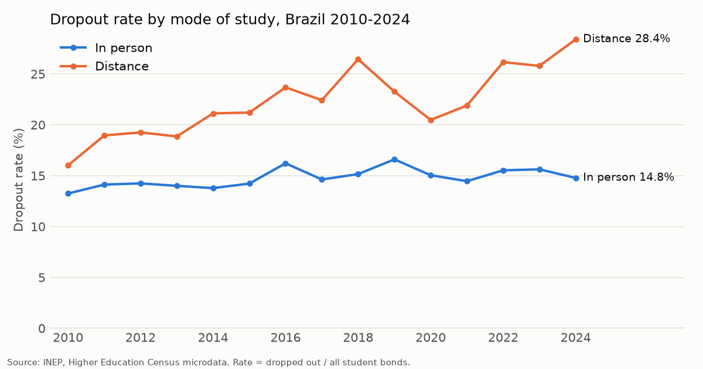

# brazil-higher-ed-dropout

[English](README.md) · **Português**

Pipeline reprodutível que baixa os microdados do Censo da Educação Superior (INEP, 2010 a 2024),
valida e converte para Parquet, e calcula taxas de evasão com DuckDB. Inclui um dashboard em Streamlit.

[](https://github.com/ErickBonruque/brazil-higher-ed-dropout/actions/workflows/ci.yml)

[](LICENSE)



## Resultado

Medido sobre os 15 censos (2010 a 2024), com o código deste repositório:

| | |
|---|---|
| Entrada | 2,2 GB de CSV (30 arquivos, 3,8 milhões de linhas de curso) |
| Saída | 20 MB de Parquet (zstd), uma partição por ano |
| Tempo do build | 18 s para os 15 anos (máquina com 12 threads) |
| Evasão em 2024 | **22,6%** (3,5 mi de 15,7 mi de vínculos) |
| EAD × presencial (2024) | 28,4% × 14,8% |
| Privada × pública (2024) | 24,7% × 12,2% |

A evasão subiu de 13,7% (2010) para 22,6% (2024). A alta vem quase toda do EAD, que no mesmo período
passou de 16,0% para 28,4%; o presencial ficou entre 13% e 17%. Tabelas completas em [`results/`](results/)
e o segundo gráfico em [`docs/img/dropout_by_network.png`](docs/img/dropout_by_network.png).

## Por que existe

Os microdados do INEP são públicos, mas difíceis de usar: ZIPs de até 2 GB, codificação Windows-1252,
colunas que mudam de posição entre edições e um arquivo que muda de nome em 2022. Este projeto
transforma tudo isso numa tabela única e tipada, que qualquer ano consulta do mesmo jeito.

## Como rodar

Demo com a amostra incluída no repositório (2% dos cursos, sem download):

```bash
uv sync --all-extras
uv run streamlit run app/dashboard.py
```

Pipeline completo (baixa cerca de 640 MB do INEP):

```bash
uv run hedrop download --years 2010-2024   # ZIP -> CSV em UTF-8, em data/raw/
uv run hedrop build                        # CSV -> data/parquet/, com relatório de qualidade
uv run hedrop rates --by census_year,modality
```

## Como funciona

```
INEP (ZIP)  ->  download  ->  extract       ->  build              ->  Parquet       ->  metrics / dashboard
                streaming     só 2 CSVs,        colunas por nome,      um arquivo        DuckDB, SQL
                retry, TLS    cp1252 -> UTF-8   tipos, junção IES,     por ano           parametrizado
                verificado                      checagens
```

- **Colunas por nome, nunca por posição.** Em 2024 o INEP inseriu 23 colunas no meio do arquivo.
  Coluna obrigatória ausente gera `LayoutError`; coluna opcional ausente vira NULL tipado, então todo
  ano tem o mesmo esquema.
- **Checagens a cada build:** ano dentro do arquivo igual ao ano pedido, concluintes ≤ matrículas,
  contagens negativas, cursos sem instituição. Todas zeradas nos 15 anos.
- **Falhas reais tratadas:**
  - O INEP diz "latin-1", mas 4 arquivos têm caracteres Windows-1252 (travessão, marcador) que um
    leitor latin-1 estrito recusa. A extração decodifica como cp1252 e grava UTF-8.
  - Em 2013 a coluna `TP_REDE` (pública/privada) está vazia em 98% das linhas. O build preenche pela
    categoria administrativa, com o mesmo mapeamento que vale em todos os outros anos (conferido nos dados).
  - O servidor do INEP envia o certificado TLS sem a CA intermediária. Em vez de desligar a
    verificação (o que a primeira versão fazia), o pacote inclui essa CA pública e verifica normalmente.
- **Download seguro para retomar:** grava em `.part` e só renomeia se o tamanho bater com
  `Content-Length`; retry com backoff em erro de rede e 5xx; ano já extraído é pulado.

### Definição da taxa

Taxa = desvinculados ÷ todos os vínculos do ano (`matriculados + trancados + desvinculados +
transferidos + falecidos`), somando antes de dividir (não é média das taxas dos cursos).

No dicionário do INEP, "matrícula" já inclui quem se formou no ano. Os dados confirmam: concluintes ≤
matrículas em todas as linhas de todas as edições. A primeira versão deste projeto (a do pôster) usava
`matriculados + concluintes + desvinculados`, o que conta concluintes duas vezes. Ela continua
disponível (`--definition legacy`) para reproduzir os números publicados: 23,5% em 2024, EAD 30,5% ×
presencial 14,8%.

## Stack

Python 3.11+, DuckDB, Parquet, requests, Streamlit + Plotly, pytest, ruff, mypy (strict), GitHub Actions, uv.

Por que DuckDB e não pandas no build: lê só as colunas usadas de um CSV de 430 MB e grava Parquet sem
carregar o arquivo em memória. O pandas fica só no dashboard.

## Limitações

- Taxa anual de evasão por vínculo, não evasão de coorte (acompanhar o mesmo aluno exige os microdados
  de aluno, que o INEP deixou de publicar).
- A queda nas públicas em 2020 e 2021 coincide com os calendários suspensos na pandemia; não testei a causa.
- A amostra do dashboard é aleatória (2% dos cursos): os números dela são aproximados.
- Censos anteriores a 2010 não foram testados.

## Contexto

Iniciação científica voluntária (PIVICT) na UTFPR, com orientação da Profa. Arlete Teresinha Beuren.
Apresentado no SICITE 2026.

## Licença

[MIT](LICENSE). Os dados são do INEP e seguem os termos de uso dele.
